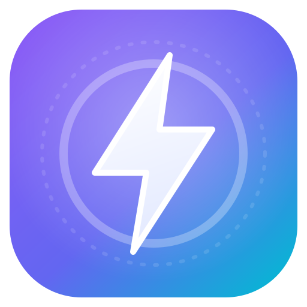
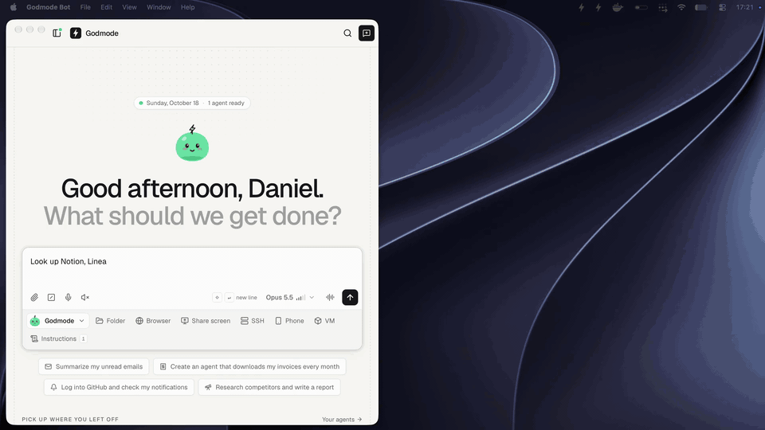

<div align="center">



# Godmode Bot

A desktop app that runs the official Claude Code CLI as a team of persistent agents, with a browser and a local vault
that types passwords and 2FA codes for them.

[](LICENSE)
[](https://github.com/codextde/godmode-bot/releases/latest)

macOS, Windows, Linux, or headless with a web dashboard ·
[Features](docs/FEATURES.md) ·
[Security](SECURITY.md) ·
[Architecture](docs/ARCHITECTURE.md) ·
[usegodmode.com](https://usegodmode.com)

</div>



<sub>A real screen recording on a Mac, sped up (typing 1.5x, browsing about 4.5x, the answer in real time). Godmode
looks up three pricing pages in its own Chrome window and answers with a table.
<a href="https://usegodmode.com/media/hero.mp4">Full-quality video (MP4, 22 s)</a></sub>

## How it works

- Every agent turn is one `claude -p` call of the official, unmodified Claude Code CLI, in the agent's own folder,
  signed in with your Claude account or an Anthropic API key. Godmode adds its tools over MCP and streams the output
  into the app.
- Each agent is a git repo: `CLAUDE.md` (instructions), `MEMORY.md`, transcripts and run logs. Every run is committed,
  so you can read, diff and undo what an agent learned. At night agents rewrite their own memory under a size limit.
- Agents browse in a Chromium that [browser-use](https://github.com/browser-use/browser-use) drives over CDP, and can
  reuse your Chrome sessions. You watch the browser live next to the chat and can take over.
- Logins, TOTP secrets and passkeys sit in a local encrypted vault. The agent calls a fill tool and Godmode types the
  value into the page, only on the login's own site. The value is not returned to the model.
- A scheduler starts agents on a schedule, on app events (a new email, a Slack message), on conditions you describe or
  from a webhook, and agents set their own follow-ups ("check again tomorrow at 10"). A main agent creates and
  supervises the others; a task board and an inbox show what they do and what they need from you.

The full feature list with screenshots is in [docs/FEATURES.md](docs/FEATURES.md).

## Install

### Free: build from source

```bash
git clone --depth 1 https://github.com/codextde/godmode-bot && cd godmode-bot
pnpm install
pnpm dev        # then open http://127.0.0.1:1420
```

Needs [Node 22+](https://nodejs.org), [pnpm](https://pnpm.io) and [Bun 1.3+](https://bun.sh). Measured on an Apple
silicon Mac with an empty pnpm cache (October 22, 2026): the clone took 2 minutes (330 MB), `pnpm install` 3 minutes,
and `pnpm dev` was up in 3 seconds. In the browser, the onboarding installs Claude Code, uv and Chromium if they are
missing, and you sign in to Claude once. Every feature, no licence key, no limits. To build your own desktop app,
server binary or Docker image, see [Build from source](docs/FEATURES.md#build-from-source).

### Pro: the official builds

The official builds run free for 7 days without a key or card, then need a Pro licence (14-day trial). Your own build
from source never asks for a key.

- **macOS**: `.dmg` for Apple silicon and Intel, signed and notarized
- **Windows**: `.msi` / `.exe`, not code-signed yet, so SmartScreen warns on first launch
- **Linux**: `.AppImage`, `.deb`, `.rpm`
- **Headless**: a one-line install script or the Docker image, with a web dashboard
  ([setup](docs/FEATURES.md#headless-server--web-dashboard))

Download from [GitHub Releases](https://github.com/codextde/godmode-bot/releases/latest) or
[usegodmode.com](https://usegodmode.com/download). Pro pays for the signed builds, automatic updates, the install
script, the Docker image and support. Prices are on [usegodmode.com](https://usegodmode.com/#pricing).

The app, browser, vault and automations run on all three systems. macOS gets the most testing, and macOS VMs for
agents need a Mac with Apple silicon.

### Phone

Android: [Godmode Bot on Google Play](https://play.google.com/store/apps/details?id=de.codext.godmode). iOS: build it
from source for now ([apps/mobile](apps/mobile/README.md)). The phone pairs with a one-time QR code and reaches your
computer over Tailscale ([setup](docs/FEATURES.md#phone-app-ios-and-android)).

## What stays local, what goes to Anthropic

- **On your machine**: the app, the vault, browser profiles, agent memory, transcripts and logs. The API listens on
  `127.0.0.1` by default.
- **To Anthropic**: the model is Claude, so what an agent reads (page text, screenshots, files it opens) goes to
  Anthropic under your account, the same as when you use Claude Code directly. Vault passwords and TOTP secrets don't:
  Godmode types them into the page itself. A one-time code can still show up in a screenshot of the page after it was
  typed.
- **Only if you set them up**: Composio (app toolkits and instant email or Slack triggers), a CAPTCHA solving service,
  an OpenAI key for browser-use page extraction or voice, ElevenLabs for voice, Tailscale for the phone app, a Godmode
  Cloud you link, and the APIs you add as tools.
- **Godmode's own servers**: no analytics or telemetry in the app. The desktop app looks for updates on
  usegodmode.com, and official builds check their licence key there every 6 hours.

## Security model

- **Vault**: your passphrase is stretched with scrypt (N=2^17) into a key that wraps a random 256-bit data key. Every
  secret is encrypted with AES-256-GCM and bound to its database row. *Remember on this device* (on by default, so
  automations run unattended) keeps the data key in the OS keychain; switch it off to type the passphrase after every
  restart.
- **Fill, don't reveal**: agents ask Godmode to type a password or 2FA code into the page over CDP, and the value never
  enters the model's context. A fill only goes into a page whose host matches the login's domains, over https, and
  passwords only into real password fields, so a lookalike page gets nothing. Reveal mode is opt-in per agent and
  needs your passphrase.
- **Audit**: known secrets are masked in transcripts, logs and the UI, and every fill and reveal is in the audit log.
- **Local API**: the core listens on `127.0.0.1`, each run gets its own MCP token that expires with the run, and the
  web dashboard has CSRF, DNS-rebinding and login rate-limit protection.

The caveat: agents run Claude Code with `--dangerously-skip-permissions` by default, so they can run any command as
your user. Fill-only keeps secrets out of the model's context, but it is not a sandbox: an agent with shell access that
is talked into misbehaving can read files your user can read or attach to the browser's debugging port. If that is too
much, switch off **Full bypass mode** (Settings → AI & Claude → Autonomy; runs then use `acceptEdits` with an
allow-list and stop more often), give sensitive agents their own macOS VM, or run Godmode on a spare machine or in
Docker. The full model, the VM isolation and how to report a vulnerability: [SECURITY.md](SECURITY.md).

## Is this allowed with a Claude subscription?

Godmode installs the official, unmodified Claude Code CLI with Anthropic's installer, and you sign in through
Anthropic's own flow (`claude auth login`, which opens Anthropic's sign-in page in your browser). The token stays in Claude Code's own keychain entry or credentials
file. Godmode only checks that it exists and when it changed; it never reads, copies or proxies it. Every request is
a normal `claude -p` call on your own account.

Anthropic's [legal and compliance page](https://code.claude.com/docs/en/legal-and-compliance) says third-party
developers may not offer Claude.ai login in their own apps or route requests through Free, Pro or Max credentials on
behalf of their users, and that this does not "prevent an end user from signing in to the unmodified Claude Code
binary with their own Claude subscription". Their
[help center](https://support.claude.com/en/articles/15036540-use-the-claude-agent-sdk-with-your-claude-plan)
(update of October 7, 2026): "You can still use the Claude Agent SDK, `claude -p`, and third-party apps with your
subscription limits."

This is not an endorsement by Anthropic. Anthropic says Pro and Max limits assume ordinary, individual use, and its
rules for third-party tools changed more than once in 2026. For heavy all-day use or for a company, use an Anthropic
API key (Max and Team plans now include monthly API credits) or a Team plan. Godmode works with both.

## More

- [docs/FEATURES.md](docs/FEATURES.md): every feature with screenshots, a quick start, and setup guides for the desktop
  app, the headless server and Docker, the phone app, Godmode Cloud, runners, computer use, macOS VMs, SSH servers,
  plugins and connecting Claude Code over MCP.
- [docs/ARCHITECTURE.md](docs/ARCHITECTURE.md): how the core, runner, vault, browser and scheduler fit together.
- [SECURITY.md](SECURITY.md): the full security model and its caveats.

## Development

```bash
pnpm install
pnpm dev          # core (bun --watch, :7777) + UI (vite, :1420)
pnpm dev:app      # full desktop app (tauri dev)
pnpm typecheck && pnpm test
pnpm build:app    # desktop bundles
```

Monorepo: `packages/shared` (types) · `packages/core` (daemon) · `apps/desktop` (UI + Tauri) · `apps/mobile` (phone
app, Expo, its own toolchain, see [apps/mobile/README.md](apps/mobile/README.md)) · `apps/cloud` (Godmode Cloud,
Next.js, see [apps/cloud/README.md](apps/cloud/README.md)). See [CONTRIBUTING.md](CONTRIBUTING.md).

## Credits

[Claude Code](https://code.claude.com) · [browser-use](https://github.com/browser-use/browser-use) · [Cua](https://github.com/trycua/cua) ·
[Composio](https://composio.dev) · [Model Context Protocol](https://modelcontextprotocol.io) ·
[Tauri](https://tauri.app) · [shadcn/ui](https://ui.shadcn.com) · [aicss](https://www.aicss.dev) ·
[claude-mem](https://github.com/thedotmack/claude-mem) · [Tart](https://tart.run) · [Bun](https://bun.sh)

## License

[MIT](LICENSE) © 2026 Codext GmbH. The official Godmode Pro builds and subscription at
[usegodmode.com](https://usegodmode.com) follow the [Terms](https://usegodmode.com/legal/terms).
